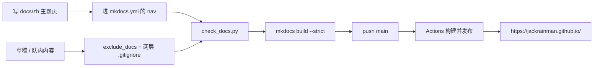

<div align="center">

# 📚 Web_of_Jackrainman

### 机器人电控与控制系统工程文档 · 控制理论 / 底盘解算 / CAN / STM32 & FreeRTOS

**化繁为简，连接理论与落地。**


</div>

个人技术站点，MkDocs Material 构建，GitHub Pages 托管在**用户站根路径**
`https://jackrainman.github.io/`。仓库是**公开的**，提交即永久。

当前状态：**模板骨架**。写作流程、校验门和部署链路已经就位，正文正在从零重写——
旧站内容因涉队内材料归档进了私有仓库，两边靠不上，所以你在站上暂时只看到首页。

---

## 目录长什么样

| 路径 | 作用 |
|---|---|
| `docs/zh/<主题>/` | 正文。同级 `Pictures/<页面名>/` 放该页配图 |
| `docs/zh/index.md` | 首页（真正渲染到 `/` 的是它，不是 `docs/index.md`） |
| `mkdocs.yml` | 主题、插件、`exclude_docs`、`nav` |
| `.agents/` | 全部 AI 产物：技能 `skills/` + 脚本 `scripts/` |
| `overrides/partials/comments.html` | 接管评论区，giscus 绑定在这里生效 |
| `docs/javascripts/` · `docs/stylesheets/` | 前端增强与 956 行自定义样式 |

---

## 五分钟跑起来

```bash
git clone https://github.com/Jackrainman/jackrainman.github.io.git
cd jackrainman.github.io
python3 -m venv .venv && source .venv/bin/activate
pip install -r requirements.txt --index-url https://pypi.org/simple
mkdocs serve
```

浏览器打开 <http://127.0.0.1:8000>。默认 pip 镜像在部分环境不可达，所以要显式指定官方源；
依赖全部按本地实测构建锁死版本，`mkdocs 2.0` 会移除插件系统，不锁版本会让 CI 某次重装直接崩。

改完之后：

```bash
python .agents/scripts/check_docs.py    # 非零不得提交
mkdocs build --strict
```

---

## 从写作到上线



**`--strict` 不够用**，它只校验 MkDocs 自己认识的引用。本站踩过的那些坑，全部由
`check_docs.py` 兜住：

| 检查项 | `mkdocs build --strict` | `check_docs.py` |
|---|:---:|:---:|
| 相对链接 / 图片指向不存在的文件 | 部分 | ✅ |
| 原生 HTML `href` / `src` 死链 | ❌ | ✅ |
| AI 残留（占位符、TODO、配图脚本清单） | ❌ | ✅ |
| `nav` 与实际文件的一致性 | 部分 | ✅ |
| `site_url` 与仓库真实地址是否匹配 | ❌ | ✅ |
| giscus 绑定在两处是否一致 | ❌ | ✅ |
| 代码块缺语言标注 | ❌ | 报告 |

真实事故：`site_url` 留空时构建零警告，但 `sitemap.xml` 每条 `<loc>` 变成 `None/...`，
站点九个月不可被索引；首页 CTA 用原生 HTML 写的死链也一路绿灯上线过。

---

## 发布与站点地址

- 用户站根路径的前提是仓库名等于 `jackrainman.github.io`；改名会**立刻**失去根路径，
  Pages 不跟随改名重定向。
- 部署走 `actions/deploy-pages@v4`，job 必须声明 `environment: github-pages`，
  否则报 `Failed to create deployment (status: 404)`，而真凶常被误认成 Pages 没开启
  （另一半真凶确实是：Settings → Pages → Source 要选 *GitHub Actions*）。
- `pages: write` 与 `id-token: write` 只授给部署 job，PR 构建不继承。
- **构建绿 ≠ 发布成功**。验收看线上：根路径 200、`sitemap.xml` 里没有 `None`、静态资源 200。

细节在 [`.agents/skills/pages-deploy/SKILL.md`](.agents/skills/pages-deploy/SKILL.md)。

## 一道贯穿全站的规矩：草稿不靠自觉

`docs/zh/` 同时是 Obsidian vault，"写进文件" 和 "公开" 之间只隔一次 `git push`。
所以私人与队内内容必须同时过两道闸——`exclude_docs` 只挡构建，挡不住 `blob/main/...` 直读：

| 目的 | 机制 |
|---|---|
| 不上线 | `mkdocs.yml` 的 `exclude_docs` + 不写进 `nav` |
| 不公开 | 根 `.gitignore` **且** `docs/zh/.gitignore` |

新笔记默认落 `docs/zh/_Drafts/`（两处拦截已配好），定稿再 `git mv` 到主题目录。

---

## 技术形态

**渲染**：MkDocs 1.6.1 + Material 9.7.7，明暗双 palette 跟随系统，中文字体当前回退系统字体。
**语言**：`mkdocs-static-i18n` 以 `folder` 结构管理，`zh` 是唯一且默认语言——因此站点直接挂在
根路径，**不存在 `/zh/` 前缀**。
**内容能力**：MathJax 3.2.2（`$...$` / `$$...$$`）、mermaid（superfences 自定义围栏）、
admonition、任务列表、代码复制与行号锚点、`mdx_truly_sane_lists` 修正嵌套列表。
**搜索**：Material 内置搜索 + jieba 中文分词。
**体积**：`mkdocs-minify-plugin` 压 HTML/JS/CSS 并移除注释。
**前端自研**（`docs/javascripts/`）：搜索框占位文案、图片懒加载、MathJax 配置、
字体预加载、首页数字滚动动画；`pangu` 自动补中西文间距。
**评论区**：giscus，由 `overrides/partials/comments.html` 硬编码接管（`mkdocs.yml` 里的
`extra.comments` 与之保持一致但不直接渲染）。

---

## AI 协作

本站把 AI 助手当成一个会犯错的同事来管理：所有 AI 产物归 `.agents/`，规则写成可执行检查，
而不是靠提示词里的自觉。

| 文件 | 干什么 |
|---|---|
| [`AGENTS.md`](AGENTS.md) | 进场必读的操作手册，刻意保持短 |
| `.agents/skills/mkdocs-docs` | 页面增删改：i18n 真实路径映射、链接与配图规范、残留清理 |
| `.agents/skills/pages-deploy` | Pages 与 Actions：命名约束、404 的两个真因、上线验收清单 |
| `.agents/skills/repo-hygiene` | 发布边界：两道闸、公开历史处置顺序、迁移与新仓库种子规则 |
| `.agents/scripts/check_docs.py` | 发布前体检门（纯标准库，无依赖） |
| `.agents/scripts/fix_code_blocks.py` | 批量补代码块语言标注，判不出的只报告不瞎猜 |

---

## 已知待办

- 🟡 **正文**——主题目录尚未建立，首页 stats 仍是旧站数字。
- 🟡 **中文字体**——17MB 的 Noto Sans SC 可变字体未收录，观感与旧站有差；补入前先子集化。
- 🔴 **评论区**——仓库未开 Discussions，`category_id` 仍是占位值，giscus 不可用。
- ⚪ **首页 CTA**——`landing-actions` 是空槽，等有真实内容页可指再填。

## 与旧站的关系

旧仓库 `Jackrainman/Jackrainman.github.io` 已改名为私有归档库
`Jackrainman/Jackrainman.github.io_archive`。本仓库从零建立历史，不含队内材料；
往回捞内容需要逐页人工过一遍再放，不批量搬。

---

本仓库尚未指定 `LICENSE`，内容与代码默认保留所有权利。

<div align="center">

**Web_of_Jackrainman** · 把踩过的坑写成下次能翻出来的答案

</div>
