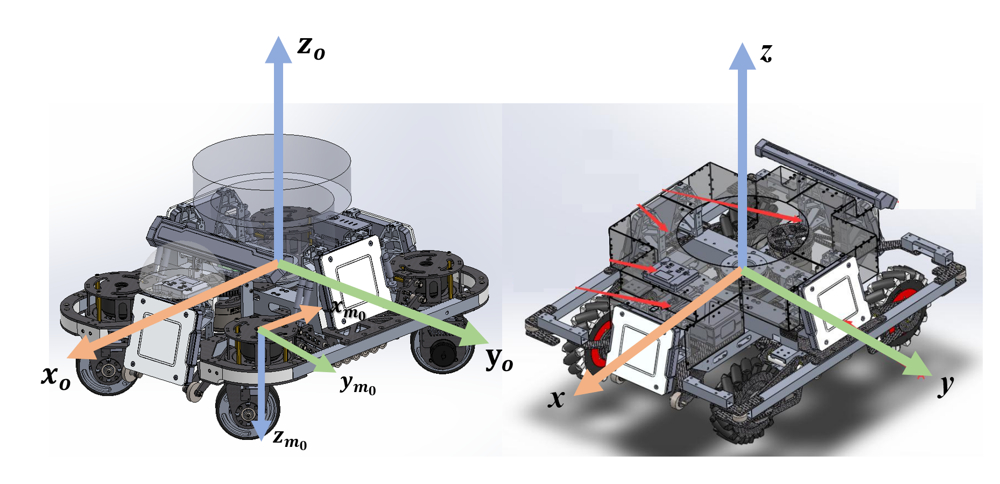
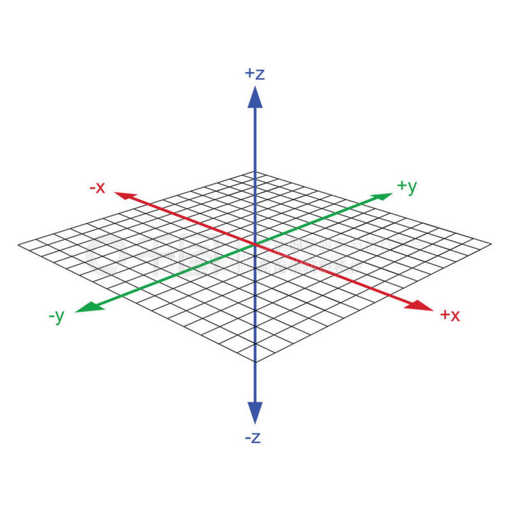

本文使用右手坐标系。读图时，先确认车头、坐标原点和各轴的正方向。

底盘运动学中，常用的车体系是**X 向前、Y 向左、Z 向上**。ROS 的 REP 103 也采用这一约定：
- **X 轴**：正前方 (Forward)
- **Y 轴**：正左方 (Left)
- **Z 轴**：正上方 (Up)

在这种坐标系下，底盘的运动学变量通常表示为：

- 前进线速度：$vx$
- 横向平移速度（针对全向轮或麦克纳姆轮底盘）：$vy$
- 绕中心旋转的角速度（偏航角速度）：$ωz$

*图片取自 HELLO WORLD 战队知识库，仅作学习交流使用，如有侵权可联系作者删除*

平面数学题常把 X 画向右、Y 画向上、Z 指向观察者。它同样是右手系，只是图中的轴方向与这里的车体系不同。不要因为习惯了纸面坐标，就把机器人的左右当作 X、前后当作 Y。

工程中的摇杆字段、速度单位和轮端命名见[底盘坐标与速度接口约定](底盘坐标与速度接口约定.md)；不同轮系的接口迁移见[三种底盘接口迁移对照](三种底盘接口迁移对照.md)。

## 这组文档怎么读

新接触底盘时，先确定坐标、单位和轮号，再看解算公式。接手旧工程时，则要把旧代码的实际行为与新约定逐项对照。

| 阅读任务 | 对应文章 | 使用时注意 |
|---|---|---|
| 确认现在共同遵守的规则 | [底盘坐标与速度接口约定](底盘坐标与速度接口约定.md) | 以这里的轴向、摇杆字段和单位为准；具体实现是否已迁移，另查代码和测试 |
| 理解轮速怎样反推车体运动 | [底盘正解算](底盘正解算.md) | 包含旧舵轮代码，阅读时区分标准刚体公式与旧安装映射 |
| 接手并修改旧接口 | [三种底盘接口迁移对照](三种底盘接口迁移对照.md) | 按模块核对差异，不把迁移清单当成已通过的测试记录 |
| 追溯舵轮中的符号和角度处理 | [旧版舵轮全链路坐标说明](steering_wheel与底盘全链路坐标轴约定.md) | 仅解释旧实现，不作为新接口约定 |

共同约定应集中维护。各轮系文章引用同一份约定，再说明自己的轮位、滚动方向、尺寸和公式，避免每篇都重新定义一套 X/Y。
