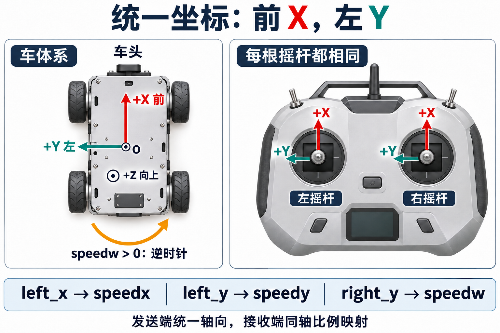

# 底盘坐标与速度接口约定

底盘、遥控器和上位机统一采用**前 X、左 Y、上 Z，俯视逆时针为正**。每根摇杆前推为 X 正、左推为 Y 正，接收端按比例生成对应方向的速度。

本文规定麦轮、全向轮和舵轮共同遵守的接口。旧代码中的轴向、单位和安装补偿尚未全部迁移，差异见[三种底盘接口迁移对照](三种底盘接口迁移对照.md)。确认实现符合约定后，才能按新接口接入。



图中左摇杆控制平移，右摇杆左右推控制转向；右摇杆前后推仍是 `right_x`。两根摇杆的轴向相同，功能分配可以不同。底盘外形只用来说明方向，不表示图中的轮系一定能横移。

## 车体速度描述哪个方向

对称底盘以轮位布局的几何中心为原点 O。坐标轴随车头转动，因此 `speedx > 0` 始终表示沿车头前进。地图中的固定方向属于世界坐标系，不能直接当作车体方向。

| 量 | 正方向 | 单位 |
|---|---|---|
| `speedx` | 前进 | m/s |
| `speedy` | 左移 | m/s |
| `speedw` | 绕 O 逆时针自转，即车头左转 | rad/s |
| 轮位、车轮半径、轴距、轮距 | 在车体系中定义 | m |
| `wheel_angle` | 0 朝前，正角从前方转向左侧 | rad |

`speedx、speedy` 是 O 点对地速度在车体系中的分量。若雷达或定位系统的参考点不在 O，除了对齐轴向，还要处理参考点偏移；“雷达也采用前 X、左 Y”不代表其坐标系与底盘完全重合。

```c
ctrl(speedx, speedy, speedw);
```

统一后的三个底盘入口都接收这些量。上层直接传角速度，不预乘底盘半径，也不随底盘类型交换 X/Y。导航若输出世界系速度，先在上层转成车体系，再调用解算。

## 每根摇杆都前推正 X 左推正 Y

发送端负责校准采样通道和正负方向。左右摇杆及以后新增的二维摇杆都按下表发送。

| 字段 | 保留四通道数组时的下标 | 正向操作 | 负向操作 |
|---|---|---|---|
| `left_x` | `rs[0]` | 左摇杆前推 | 左摇杆后拉 |
| `left_y` | `rs[1]` | 左摇杆左推 | 左摇杆右推 |
| `right_x` | `rs[2]` | 右摇杆前推 | 右摇杆后拉 |
| `right_y` | `rs[3]` | 右摇杆左推 | 右摇杆右推 |

这些字段仍是无量纲摇杆输入。若已归一化到 `[-1, 1]`，接收端可以这样生成目标速度：

```c
target_speedx = left_x * max_speedx;   // m/s
target_speedy = left_y * max_speedy;   // m/s
target_speedw = right_y * max_speedw;  // rad/s，左推左转
```

若报文发送整数，比例系数还要包含满量程换算。死区、慢速倍率、限幅和加速度规划不改变轴向。旧分段手感曲线是否保留也要写清楚，避免同一摇杆值在不同工程中产生不同的速度关系。

`right_y → speedw` 是转向功能分配，不是纠正坐标轴。某个模式若使用右摇杆控制平移，仍然是 `right_x → speedx`、`right_y → speedy`。

旧协议常把水平叫 X、垂直叫 Y。改为新定义后，即使报文长度不变，字段含义也已改变。发送固件、接收结构、数组使用方、界面和日志要同步更新，并用版本或消息类型区分。升降、夹杆也使用这些通道，需要一起核对。

## 角度和角速度是两种量

| 名称 | 描述什么 | 例子 |
|---|---|---|
| 车身航向 `yaw_angle` | 车头相对参考坐标的朝向 | `pi/2 rad` 表示一个角度 |
| 舵角 `wheel_angle` | 轮子相对车体的转向角 | `pi/2 rad` 表示朝左 |
| 底盘角速度 `speedw` | 车头朝向变化的快慢 | `1 rad/s` |
| 旋转切向线速度 | 某轮位因底盘自转产生的线速度 | `speedw * chassis_radius`，单位 m/s |

`rad` 与 `deg` 都是角度单位，`rad/s` 是角速度单位。把 `world_angle` 从 deg 换成 rad，不能解决 `speedw` 被当成线速度的问题。

车体系解算不需要世界航向，因此新接口初始化时不保存 `world_angle`。航向由需要世界坐标的导航层管理。旧接口若仍使用 deg，就在调用旧接口时转换单位。

## 从车体速度到电机 RPM

车体速度要经过轮系解算和电机换算，才能成为电机目标。轮端接口采用轮轴 rad/s 时，解算处理轮位和轮径，电机适配处理减速比、安装方向及驱动协议单位。

```text
摇杆 / 上位机
    → 车体系 speedx、speedy、speedw
    → 底盘运动学解算
    → 各轮 wheel_speed（轮轴 rad/s）
    → 电机适配：方向、减速比、单位
    → target_motor_rpm
    → 电机速度闭环

feedback_motor_rpm
    → 反向换算为轮轴反馈
    → 底盘正解算
    → feedback_speedx、feedback_speedy、feedback_speedw
```

设车轮半径为 `r`，总减速比为 `g = 电机轴转速 / 轮轴转速`，先只考虑单位与传动比：

```text
wheel_rpm = wheel_speed * 60 / (2*pi)
motor_rpm = wheel_rpm * g
wheel_linear_speed = wheel_speed * r

motor_rpm = wheel_linear_speed * 60*g / (2*pi*r)
wheel_linear_speed = motor_rpm * 2*pi*r / (60*g)
```

`wheel_speed` 的单位为 rad/s，`wheel_linear_speed` 为 m/s。电机安装反向另用一致的方向系数处理，目标和反馈必须互逆。

| 用途 | 命名 | 单位与要求 |
|---|---|---|
| 车体速度 | `speedx、speedy、speedw` | m/s、m/s、rad/s |
| 车体目标 | `target_speedx、target_speedy、target_speedw` | 与车体速度一致 |
| 车体反馈 | `feedback_speedx、feedback_speedy、feedback_speedw` | 同坐标系、同参考点 |
| 轮缘线速度 | `wheel_linear_speed` | m/s |
| 轮轴角速度 | `wheel_speed` | rad/s，声明处明确是轮轴 |
| 轮轴机械转速 | `wheel_rpm` | r/min，减速器之后 |
| 电机轴机械转速 | `motor_rpm` | r/min，减速器之前 |
| 电机目标 / 反馈 | `target_motor_rpm、feedback_motor_rpm` | 速度 PID 比较的两个量必须属于同一根轴 |
| 电角转速 | `motor_erpm` | 仅在相应驱动协议中使用，不等于机械 RPM |

状态词统一使用 `target_` 和 `feedback_`。底盘三个速度字段沿用舵轮的 `speedx/speedy/speedw` 风格；`yaw` 留给角度，不再用 `target_yaw` 命名角速度。

同一根轴的 rad/s 转 RPM 可以命名为 `RADPS_TO_RPM`，不能叫 `RAD_TO_RPM`。这个转换只换单位，不包含减速比。旧驱动的公开字段如 `motor.speed_rpm` 可以在兼容期保留，业务层显式取为 `feedback_motor_rpm`。

## 怎样确认接口已经一致

先直接输入标准速度，再接入遥控器和上位机。这样可以分别验证轮系解算与输入映射。

| 输入或操作 | 预期 |
|---|---|
| 正 / 负 `speedx` | 前进 / 后退 |
| 正 / 负 `speedy` | 左移 / 右移 |
| 正 / 负 `speedw` | 逆时针 / 顺时针自转 |
| 改变机器人在场地中的朝向 | 相同指令仍沿相同车体方向执行 |
| 左右两根摇杆分别前后左右推 | 四个报文字段及正负符合摇杆表 |
| 同一速度由遥控与上位机分别输入 | 在相同状态、限制和时序下，轮端目标一致 |
| 正解算反馈 | 方向和单位与输入一致；速度大小另外做定量验证 |

正逆解算能还原输入，只能说明两套公式互相对应。轮号和安装方向是否正确，还要与独立的几何计算、实车运动核对；打滑造成的误差也不会因正解算而消失。
