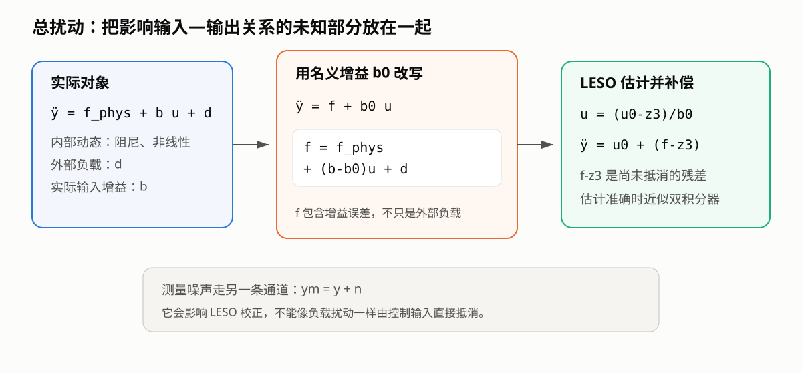
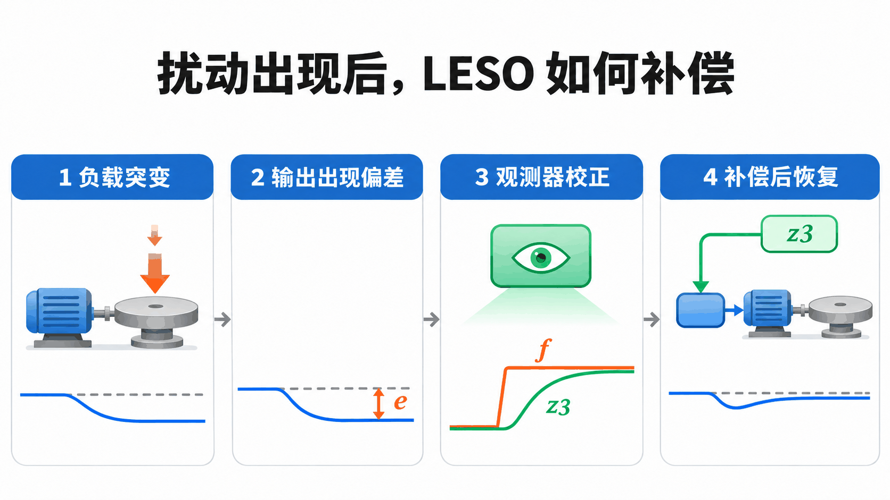

# 何谓自抗扰？

> **最近修改日期**：2026-11-04
>
> **参与者**：Jackrainman
>
> **配套资源**：[B站视频讲解](https://www.bilibili.com/video/BV124411f7CU/)

自抗扰控制（Active Disturbance Rejection Control，ADRC）要解决的问题很直接：模型不够准、负载会变化，控制器仍要把输出稳住。

它并不要求精确知道每个扰动来自哪里，而是把影响输入—输出关系的未知部分合并成“总扰动”，再用扩张状态观测器（ESO）在线估计并补偿。

## 1. 从总扰动开始

以二阶对象为例，实际动态写成

$$
\ddot y=f_{\text{phys}}+bu+d
$$

其中 $f_{\text{phys}}$ 可以包含阻尼、弹性、非线性和未建模动态，$d$ 是外部负载扰动，$b$ 是实际输入增益。

控制器通常拿不到准确的 $f_{\text{phys}}$ 和 $b$，只能选择一个名义增益 $b_0$，把对象改写成

$$
\ddot y=f+b_0u
$$

$$
f=f_{\text{phys}}+(b-b_0)u+d
$$

这里的 $f$ 就是总扰动。它既包含对象本身的未知动态，也包含输入增益估计误差。

测量噪声需要单独处理。若测得的是

$$
y_m=y+n
$$

噪声 $n$ 会进入观测器校正项，但它不是作用在对象上的负载扰动，不能指望通过控制输入直接抵消。

## 2. 为什么补偿后会变成积分器串联型

假设 ESO 给出的总扰动估计是 $z_3$，取控制律

$$
u=\frac{u_0-z_3}{b_0}
$$

代回对象可得

$$
\ddot y=u_0+(f-z_3)
$$

如果 $z_3\approx f$，剩下的就是

$$
\ddot y\approx u_0
$$

原本夹杂阻尼、负载和参数误差的对象，从 $u_0$ 到 $y$ 看就近似成了双积分器。接下来只需为双积分器设计状态反馈，不必逐项处理每种扰动。

实际系统仍有残差 $f-z_3$。扰动变化越快、测量噪声越大、采样越慢，想把这个残差压小就越困难。

把一次负载突变按时间展开，补偿过程如下。图中曲线只表示变化方向，不是定量仿真；第四格进入补偿环节的是 $z_3$，残差 $f-z_3$ 留在对象方程中。

## 3. ESO 多估计了一个状态

普通二阶对象有两个原生状态：

$$
x_1=y,\qquad x_2=\dot y
$$

ESO 再增加一个状态 $x_3=f$，于是有

$$
\begin{cases}
\dot x_1=x_2\\
\dot x_2=x_3+b_0u\\
\dot x_3=\dot f
\end{cases}
$$

观测器并不知道 $\dot f$，而是利用输出估计误差 $e=y_m-z_1$ 修正三个估计值：

$$
\begin{cases}
\dot z_1=z_2+l_1e\\
\dot z_2=z_3+b_0u+l_2e\\
\dot z_3=l_3e
\end{cases}
$$

对这里的二阶对象，$z_1,z_2,z_3$ 分别估计位置、速度和总扰动。推广到其他阶数时，状态数量也随之变化：

- 一阶对象估计 $y,f$，使用二阶 ESO，扰动估计记为 $z_2$；
- 二阶对象估计 $y,\dot y,f$，使用三阶 ESO，扰动估计记为 $z_3$；
- $n$ 阶对象估计 $y$ 到 $y^{(n-1)}$，再增加总扰动，共 $n+1$ 个状态。

对恒值扰动，合适的观测器增益可以让估计误差渐近衰减。对时变扰动，$\dot f$ 会作为误差方程的驱动项，通常只能把误差控制在一定范围内，不能保证任意情况下都归零。

## 4. ADRC 与 LADRC 的区别

经典 ADRC 常由三部分组成：

| 环节 | 输入 | 作用 |
|---|---|---|
| 跟踪微分器 TD | 参考指令 | 安排过渡过程，给出平滑参考及其微分 |
| 扩张状态观测器 ESO | 输出测量和控制输入 | 估计原生状态与总扰动 |
| 非线性状态误差反馈 NLSEF | 参考与状态估计 | 生成虚拟控制量 |

LADRC 把 ESO 和反馈控制律改为线性形式，分别记为 LESO 和 LSEF，再用带宽法集中整定参数。TD 在 LADRC 中仍然是可选的参考预处理环节，不是每个实现都必须使用。

非线性 ADRC 中常见的 `fal` 函数为

$$
\operatorname{fal}(e,\alpha,\delta)=
\begin{cases}
|e|^\alpha\operatorname{sgn}(e),&|e|>\delta\\
e/\delta^{1-\alpha},&|e|\leq\delta
\end{cases}
$$

当 $0<\alpha<1$ 时，小误差区间采用高斜率线性反馈，大误差区间采用分数幂反馈。非线性结构不必然优于线性结构，是否值得使用要看对象、噪声和整定成本。

## 5. 怎样确定 ADRC 的阶数

这里看的是输入到输出的相对阶：输出至少需求导多少次，输入 $u$ 才首次显式出现。

$$
\dot y=f+b_0u
$$

是一阶对象，配二阶 ESO；

$$
\ddot y=f+b_0u
$$

是二阶对象，配三阶 ESO。

物理环节的数量不能直接当作相对阶，因为有些环节只是代数关系：

- 力输入、位移输出的质量—弹簧—阻尼系统：力先产生加速度，再积分得到速度和位移，相对阶为 2；
- 电流或转矩输入、角度输出的电机：相对阶通常为 2；
- 电压输入、角度输出且保留电流动态的电机：电流环增加一阶动态，相对阶为 3；若忽略电气动态，则仍可近似为 2 阶。

## 6. 使用前需要知道什么

ADRC 不需要精确模型，但并非完全不需要模型。至少应确认：

1. 输入到输出的相对阶；
2. 控制输入的作用方向；
3. 名义输入增益 $b_0$ 的大致量级和符号；
4. 采样周期、执行器限幅和测量噪声是否允许所选带宽。

观测器带宽越高，扰动估计通常越快，但噪声、量化误差和未建模高频动态也会更明显。常见的 $\omega_o=(3\sim5)\omega_c$ 只是调试起点，不是普遍的稳定性定理。

下一篇 [《线性自抗扰控制（LADRC）详解》](./06-LADRC算法详解.md) 会用同一个二阶对象完整推导 LESO、控制律和离散实现。

## 参考资料

- 韩京清：《自抗扰控制技术》
- Gao Z., *Scaling and Bandwidth-Parameterization Based Controller Tuning*, 2003
