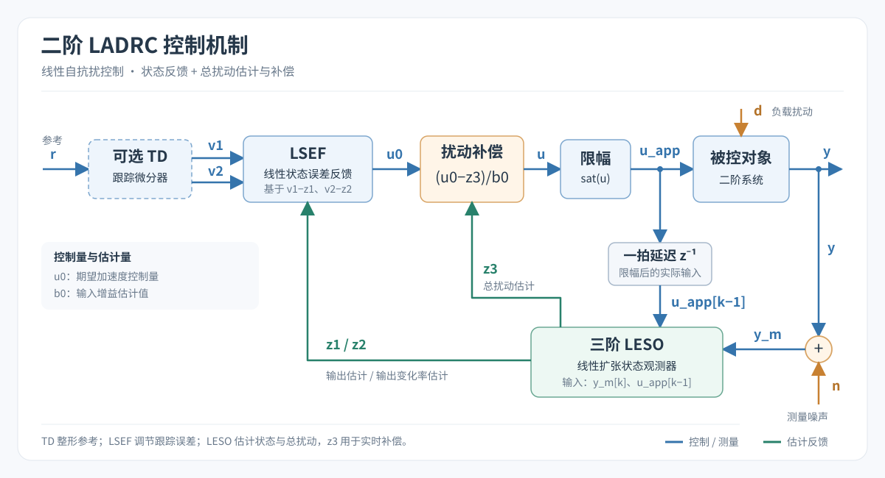
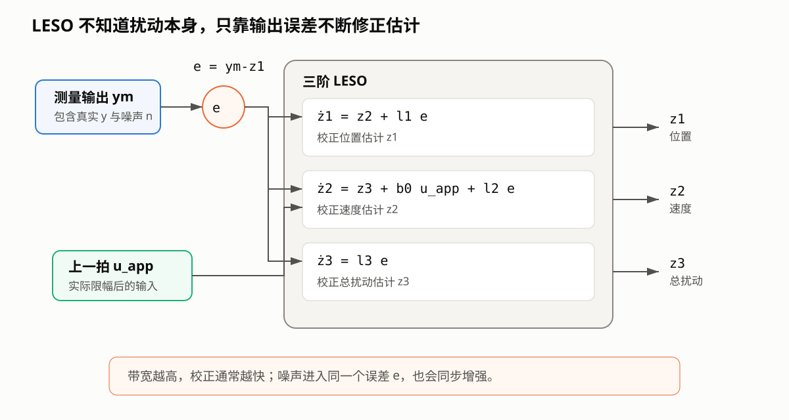

# 线性自抗扰控制（LADRC）详解

> **最近修改日期**：2026-11-04
>
> **参与者**：Jackrainman
>
> **前置知识**：[何谓自抗扰](./05-何谓自抗扰.md)

本篇以电流输入的二阶电机位置环为例，推导 LESO、控制律和前向欧拉离散实现。全文使用同一组符号，下一篇的 C 代码也沿用这套约定。

## 1. 对象、总扰动与符号

考虑带黏性阻尼和负载转矩的电机：

$$
J\ddot\theta+c\dot\theta=K_tu+\tau_d
$$

其中 $u$ 是实际电流，单位 A；$\theta$ 是角度，单位 rad。除以 $J$，并令 $y=\theta$，得到

$$
\ddot y=-\frac{c}{J}\dot y+\frac{K_t}{J}u+\frac{\tau_d}{J}
$$

实际输入增益为 $b=K_t/J$。控制器使用名义值 $b_0$，把对象整理成

$$
\boxed{\ddot y=f+b_0u}
$$

$$
f=-\frac{c}{J}\dot y+(b-b_0)u+\frac{\tau_d}{J}
$$

$f$ 是总扰动。阻尼、负载以及输入增益误差都可以放进 $f$，无需分别精确建模。

| 符号 | 含义 |
|---|---|
| $y,y_m$ | 实际输出与测量输出，$y_m=y+n$ |
| $b,b_0$ | 实际输入增益与控制器使用的名义值 |
| $f,z_3$ | 总扰动及其估计值 |
| $u_0$ | 期望的角加速度，单位 rad/s² |
| $u_{\mathrm{req}},u_{\mathrm{app}}$ | 请求电流与实际限幅后电流 |
| $h$ 或 `dt` | 控制周期，单位 s |
| $\omega_c,\omega_o$ | 控制器与观测器带宽，单位 rad/s |

测量噪声 $n$ 通过 $y_m$ 进入 LESO，不归入对象的总扰动 $f$。



## 2. 三阶 LESO

### 2.1 状态扩张

选取

$$
x_1=y,\qquad x_2=\dot y,\qquad x_3=f
$$

扩张后的对象为

$$
\begin{cases}
\dot x_1=x_2\\
\dot x_2=x_3+b_0u_{\mathrm{app}}\\
\dot x_3=\dot f
\end{cases}
$$

LESO 不知道 $\dot f$，只使用输出测量和实际施加的控制输入：

$$
e=y_m-z_1
$$

$$
\boxed{
\begin{cases}
\dot z_1=z_2+l_1e\\
\dot z_2=z_3+b_0u_{\mathrm{app}}+l_2e\\
\dot z_3=l_3e
\end{cases}}
$$

$z_1,z_2,z_3$ 分别估计位置、速度和总扰动。



### 2.2 观测器增益

先忽略测量噪声，定义估计误差 $\tilde x_i=x_i-z_i$，则

$$
\begin{cases}
\dot{\tilde x}_1=\tilde x_2-l_1\tilde x_1\\
\dot{\tilde x}_2=\tilde x_3-l_2\tilde x_1\\
\dot{\tilde x}_3=\dot f-l_3\tilde x_1
\end{cases}
$$

对恒值扰动，$\dot f=0$，误差系统的特征多项式为

$$
s^3+l_1s^2+l_2s+l_3
$$

把三个极点都配置在 $-\omega_o$：

$$
(s+\omega_o)^3=s^3+3\omega_os^2+3\omega_o^2s+\omega_o^3
$$

比较系数可得

$$
\boxed{l_1=3\omega_o,\qquad l_2=3\omega_o^2,\qquad l_3=\omega_o^3}
$$

推广到 $n$ 阶对象，$(n+1)$ 阶 LESO 的增益为

$$
l_k=\binom{n+1}{k}\omega_o^k,\qquad k=1,\ldots,n+1
$$

若 $\dot f\neq0$，它仍是误差方程的驱动项。提高 $\omega_o$ 通常能减小时变扰动的估计滞后，但也会增强测量噪声的影响。

## 3. 控制律

### 3.1 先设计虚拟控制量

TD 可以提供平滑参考 $v_1$ 和参考速度 $v_2$。二阶 LSEF 写成

$$
\boxed{u_0=k_p(v_1-z_1)+k_d(v_2-z_2)}
$$

不使用 TD 时，本实现取 $v_1=r,v_2=0$，适用于常量或分段常量参考。跟踪连续时变轨迹时，应提供合适的参考速度，不能默默把 $\dot r$ 当成零。

补偿和限幅分别为

$$
u_{\mathrm{req}}=\frac{u_0-z_3}{b_0}
$$

$$
u_{\mathrm{app}}=\operatorname{sat}(u_{\mathrm{req}})
$$

未饱和时，$u_{\mathrm{app}}=u_{\mathrm{req}}$，代回对象得

$$
\ddot y=u_0+(f-z_3)
$$

饱和时还要保留执行器误差项：

$$
\ddot y=u_0+(f-z_3)+b_0(u_{\mathrm{app}}-u_{\mathrm{req}})
$$

理想估计且无限幅时，$\ddot y\approx u_0$。令跟踪误差 $e_r=r-y$，并使用 $v_1=r,v_2=\dot r$。对 $\ddot r=0$ 的常量或匀速参考，理想闭环误差满足

$$
\ddot e_r+k_d\dot e_r+k_pe_r=0
$$

一般时变轨迹还会在等式右侧留下 $\ddot r$；若已知参考加速度，可在 $u_0$ 中加入 $\ddot r$ 前馈。

把两个闭环极点配置在 $-\omega_c$：

$$
(s+\omega_c)^2=s^2+2\omega_cs+\omega_c^2
$$

因此

$$
\boxed{k_p=\omega_c^2,\qquad k_d=2\omega_c}
$$

$k_d$ 提供速度反馈阻尼，不能由 $b_0$ 代替。$b_0$ 只负责把期望加速度和扰动估计换算成执行器输入。

## 4. 前向欧拉离散实现

本篇和下一篇的 C 代码统一采用“连续增益 + 前向欧拉”，不使用精确 ZOH 离散增益。

第 $k$ 拍读取 $y_m[k]$，用上一拍实际输出 $u_{\mathrm{app}}[k-1]$ 更新观测器，再计算本拍输出：

```c
// z1、z2、z3 和 u_prev 都是本拍更新前的旧状态
float e = y_meas - z1;
float dz1 = z2 + l1 * e;
float dz2 = z3 + b0 * u_prev + l2 * e;
float dz3 = l3 * e;

// 三个导数都先算完，再更新状态
z1 += h * dz1;
z2 += h * dz2;
z3 += h * dz3;

float u0 = kp * (v1 - z1) + kd * (v2 - z2);
float u_req = (u0 - z3) / b0;
float u_app = clamp(u_req, -u_max, u_max);
u_prev = u_app;  // 下一拍 LESO 使用实际限幅输出
```

状态更新必须全部使用本拍更新前的旧值。若先更新 `z1`，再用新 `z1` 重新计算误差和其余导数，就不是这里推导的同步欧拉更新。

### 采样周期约束

在无噪声、恒值扰动的理想误差模型中，连续观测器极点为 $-\omega_o$。前向欧拉后，对应的离散极点为

$$
\lambda=1-\omega_oh
$$

仅从这个理想模型看，稳定要求

$$
0<\omega_oh<2
$$

接近边界会产生明显振铃，不能把 2 当成可用设计值。本系列示例从 $\omega_oh\leq0.1$ 开始，并同时检查 $\omega_ch$、计算时延、量化和噪声。这是保守的调试起点，不是完整闭环的通用稳定判据。

## 5. 一个完整数值例

取电机参数

$$
J=0.01\ \mathrm{kg\,m^2},\qquad
K_t=0.05\ \mathrm{N\,m/A},\qquad
c=0.02\ \mathrm{N\,m\,s}
$$

则

$$
b=\frac{K_t}{J}=5\ \mathrm{rad/(s^2A)},\qquad
\frac{c}{J}=2\ \mathrm{s^{-1}}
$$

先假设辨识得到 $b_0=5$。选择

$$
h=0.001\ \mathrm{s},\qquad
\omega_c=10\ \mathrm{rad/s},\qquad
\omega_o=40\ \mathrm{rad/s}
$$

控制器和观测器参数为

| 参数 | 数值 |
|---|---:|
| $k_p=\omega_c^2$ | $100\ \mathrm{s^{-2}}$ |
| $k_d=2\omega_c$ | $20\ \mathrm{s^{-1}}$ |
| $l_1=3\omega_o$ | $120\ \mathrm{s^{-1}}$ |
| $l_2=3\omega_o^2$ | $4800\ \mathrm{s^{-2}}$ |
| $l_3=\omega_o^3$ | $64000\ \mathrm{s^{-3}}$ |
| $\omega_oh$ | $0.04$ |

若电流限制为 $\pm2$ A，初始参考为 1 rad，且估计状态仍为零，则初始请求为

$$
u_{\mathrm{req}}=\frac{100\times1}{5}=20\ \mathrm{A}
$$

实际输出会被限制为 2 A。这个例子说明：带宽选择不能脱离执行器能力，LESO 也应使用实际的 2 A，而不是请求的 20 A。

## 6. 参数整定顺序

### 6.1 先估计 $b_0$

阶跃前让对象保持静止并处于无扰平衡。若输入从零跳到 $U$，且 $f(0)=0$，则

$$
b_0\approx\frac{\ddot y(0^+)}{U}
$$

实际测试应使用输入生效后的局部数据拟合初始加速度，并考虑摩擦、时延和测量噪声。若 $u$ 是 PWM 占空比或归一化命令，还要包含驱动器和母线电压的换算，不能直接使用 $K_t/J$。

### 6.2 再调带宽

1. 从保守的 $\omega_c$ 开始，逐步提高，观察超调、控制量和饱和时间；
2. 取 $\omega_o=(3\sim5)\omega_c$ 作为初始范围，再根据扰动残差和噪声调整；
3. 每次修改带宽都重新检查 $\omega_oh$ 和实际采样时序；
4. 最后用恒值扰动、时变扰动和不同负载验证，不只看一次空载阶跃。

### 6.3 最后核对 $b_0$

固定其他参数时，$b_0$ 偏小会放大控制请求，$b_0$ 偏大会缩小控制请求。如果振荡确实来自 $b_0$ 偏小，可尝试增大配置值；响应过慢且 $b_0$ 偏大时，可尝试减小配置值。

振荡和迟缓都不是 $b_0$ 的特异性症状。带宽过高、采样过慢、控制方向错误和长期饱和也可能产生类似现象。

## 7. 适用边界

- LADRC 不需要精确模型，但需要正确的相对阶、输入方向和合理的 $b_0$；
- LESO 通常在扰动造成可观测影响后才能估计并补偿，不是未知扰动的预测器；
- 输出饱和时，实际对象无法继续执行理想控制律，应把实际输出回送给 LESO；
- 高带宽同时受到噪声、采样、时延和未建模动态限制；
- 与 PID 的比较应在相同对象、采样、滤波和限幅条件下进行。

下一篇 [《LADRC代码实战》](./07-LADRC代码实战.md) 给出与本文公式对应的 C 实现和主机测试。

## 参考资料

- 韩京清：《自抗扰控制技术》
- Gao Z., *Scaling and Bandwidth-Parameterization Based Controller Tuning*, 2003
