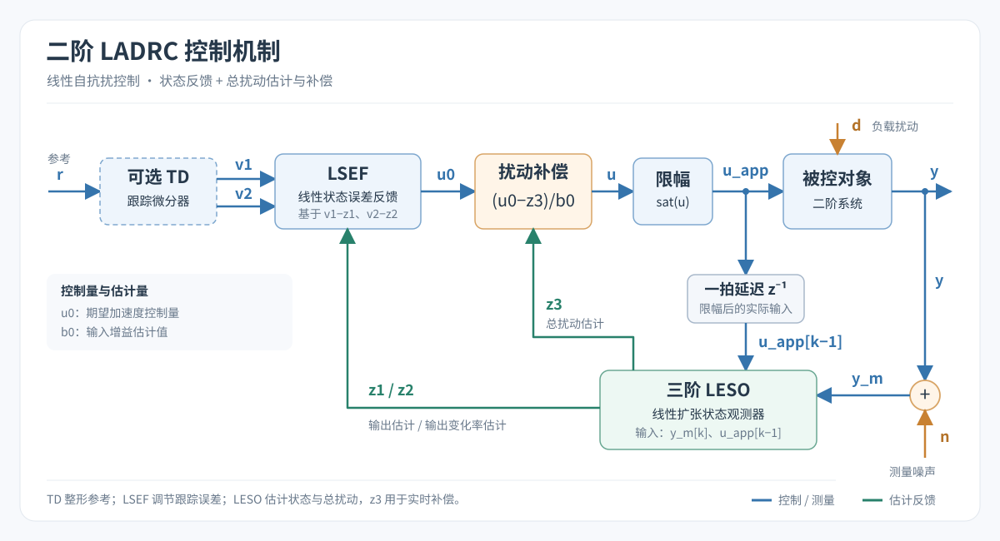
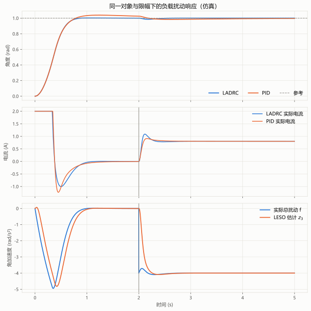
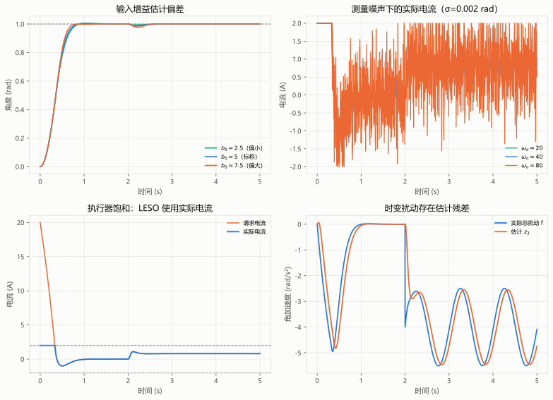

# LADRC 实战指南

> **最近修改日期**：2026-11-04
>
> **参与者**：Jackrainman
>
> **前置知识**：[LADRC算法详解](./06-LADRC算法详解.md) / [LADRC代码实战](./07-LADRC代码实战.md)

这篇不重复推导公式，重点讲实际调试时的顺序、测试方法和常见误判。文中的曲线全部来自同一个电机仿真，不是实物测试结果。

## 1. 先确认控制结构

二阶 LADRC 的信号关系如下。注意 LESO 的两个输入是测量输出 $y_m$ 和实际施加的控制量 $u_{\mathrm{app}}$；总扰动作用于对象，不是直接送给 LESO 的已知信号。

实际接线或写代码时，先检查两件事：控制方向是否正确，LESO 使用的是否为限幅后的输出。这两处错了，后面调带宽很难补救。

## 2. 固定一组测试条件

本文使用的模型为

$$
\ddot\theta=-2\dot\theta+5u+d
$$

参考角度为 1 rad，在 2 s 时加入 $d=-4$ rad/s² 的恒值负载扰动。

| 参数 | 数值 |
|---|---:|
| 采样周期 $h$ | 0.001 s |
| 名义输入增益 $b_0$ | 5 rad/(s²·A) |
| 控制器带宽 $\omega_c$ | 10 rad/s |
| 观测器带宽 $\omega_o$ | 40 rad/s |
| 电流限制 | ±2 A |
| $k_p,k_d$ | 100 s⁻²，20 s⁻¹ |
| $l_1,l_2,l_3$ | 120 s⁻¹，4800 s⁻²，64000 s⁻³ |

对应的 C 示例是 [example_ladrc.c](代码/example_ladrc.c)。Python 仿真脚本位于仓库 `.agents/scripts/ladrc/simulate_ladrc.py`，固定随机种子为 `20261104`，可重新生成本文曲线和指标。

## 3. 测量 $b_0$

对二阶对象，$b_0$ 表示单位输入能够产生多少角加速度。阶跃前让电机静止并处于无扰平衡，输入从零变到 $U$，则可用

$$
b_0\approx\frac{\ddot y(0^+)}{U}
$$

估计输入增益。

实际操作时不要用编码器相邻三点硬算二阶差分。噪声会被 $1/h^2$ 放大，输入生效时刻也可能正好落在两个采样点之间。更稳妥的做法是取输入生效后的一小段数据，对初始加速度做局部拟合，并重复几次试验。

还要注意输入单位：

- $u$ 是实际电流时，才可直接使用 $K_t/J$；
- $u$ 是电压时，需要包含电阻和电气动态；
- $u$ 是 PWM 占空比或归一化命令时，还要换算驱动器增益和母线电压。

开环阶跃试验应从低幅值开始，设置限流、限速和行程保护，并保留急停。位置机构还要防止因持续加速撞到机械限位。

## 4. 调带宽时同时看输出和控制量

### 4.1 控制器带宽 $\omega_c$

$\omega_c$ 提高后，理想闭环响应会加快，但初始控制请求也会按 $\omega_c^2$ 增长。本文例子在零初始状态下，仅位置误差一项就会产生

$$
u_{\mathrm{req}}(0)=\frac{\omega_c^2r}{b_0}=20\ \mathrm{A}
$$

远超 2 A 的电流限制。因此，调试时不能只看输出曲线是否够快，还要看请求电流、实际电流和饱和持续时间。

### 4.2 观测器带宽 $\omega_o$

可以从 $\omega_o=(3\sim5)\omega_c$ 开始，但这只是经验范围。估计滞后明显时可以适当提高 $\omega_o$；测量噪声和控制量抖动变大时，应降低带宽或改善测量。

每次调整都要检查 $\omega_oh$。本文取 $\omega_oh=0.04$。前向欧拉的理想 LESO 在 $\omega_oh$ 接近 2 时已接近稳定边界，不能把“还没有发散”当作可用裕度。

### 4.3 最后检查 $b_0$

固定其他参数时：

- 配置的 $b_0$ 偏小，控制请求会放大，可能增加超调和饱和；
- 配置的 $b_0$ 偏大，控制请求会缩小，响应可能变慢。

振荡不一定意味着 $b_0$ 偏小，响应慢也不一定意味着它偏大。先排除带宽、采样、时延、控制方向和长期饱和，再微调 $b_0$。

## 5. 仿真结果怎么读

### 5.1 恒值负载扰动

下图比较了同一对象、采样周期和 ±2 A 限幅下的 LADRC 与 PID。PID 使用 $K_p=20,K_i=12,K_d=3.6$，微分滤波时间常数为 0.02 s，并采用条件积分抗饱和。

| 指标 | LADRC | PID |
|---|---:|---:|
| 扰动前超调量 | 0.246% | 3.868% |
| 全程绝对误差积分 IAE | 0.368 rad·s | 0.429 rad·s |
| 扰动后恢复情况 | 未越出 ±0.02 rad | 56 ms 后回到 ±0.02 rad |
| 实际电流 RMS | 0.842 A | 0.845 A |
| 最大请求电流 | 20 A | 20 A |

在这组参数下，LADRC 的超调和本例 IAE 较小，两者的电流 RMS 接近。这个结果不能推出“LADRC 总是优于 PID”：更换 PID 积分增益、滤波方式、参考整形或执行器限制，结果都会变化。

第三张子图还显示，负载在 2 s 突变后，$z_3$ 需要一段时间才接近真实总扰动。LESO 是依据测量和控制输入进行在线校正，不是在未知扰动影响输出之前就能预测它。

### 5.2 参数偏差、噪声、饱和和时变扰动

四组结果分别说明：

1. 左上：$b_0$ 偏小时，本例初始饱和更明显；$b_0$ 偏大时响应略慢。
2. 右上：测量噪声标准差为 0.002 rad 时，提高 $\omega_o$ 会显著放大电流抖动。
3. 左下：初始请求电流达到 20 A，实际电流被限制在 2 A；LESO 使用实际电流。
4. 右下：负载叠加正弦变化后，$z_3$ 存在相位滞后和瞬时残差，不会与真实总扰动完全重合。

## 6. 一套可重复的调试流程

1. 检查方向和单位：用小输入确认输出方向，记录 $u,y,h,b_0$ 的单位。
2. 估计 $b_0$：在低幅值、有限速和急停条件下做阶跃辨识。
3. 从低带宽开始：先调 $\omega_c$，同时观察输出、请求控制量和实际限幅量。
4. 调整 $\omega_o$：分别测试恒值扰动、时变扰动和测量噪声，不只观察空载阶跃。
5. 验证边界：改变负载和 $b_0$，检查饱和恢复、采样周期、计算时延与传感器异常。

建议每次试验都保存 `target、y、u_req、u_app、z1、z2、z3`。只有输出曲线时，很难分清问题来自控制器、观测器还是执行器。

## 7. 常见问题排查

| 现象 | 优先检查 |
|---|---|
| 输出一上就饱和 | 参考是否突变、$\omega_c$ 是否过高、$b_0$ 是否偏小、限幅是否符合执行器 |
| 持续振荡 | 控制方向、`kd`、$\omega_c/\omega_o$、采样周期和计算时延 |
| 扰动估计滞后 | $\omega_o$、测量滤波、扰动变化速度、实际输出是否回送 LESO |
| 高频电流抖动 | 测量噪声、$\omega_o$、量化、微分与滤波实现 |
| 启用 TD 后行为突变 | TD 是否完整初始化、`r` 的单位、reset 是否清空了运行中状态 |
| 换负载后响应变化 | $b_0$ 偏差、总扰动残差、饱和时间，不要只重新加增益 |

二阶控制器不要使用“`kd=0`，由 $b_0$ 提供阻尼”的做法。$b_0$ 是输入增益，$k_d$ 才是速度反馈项。

本文只完成了主机代码测试和数值仿真。实际部署前仍需在目标 MCU 上检查执行时间、数值范围、任务周期和故障保护。
